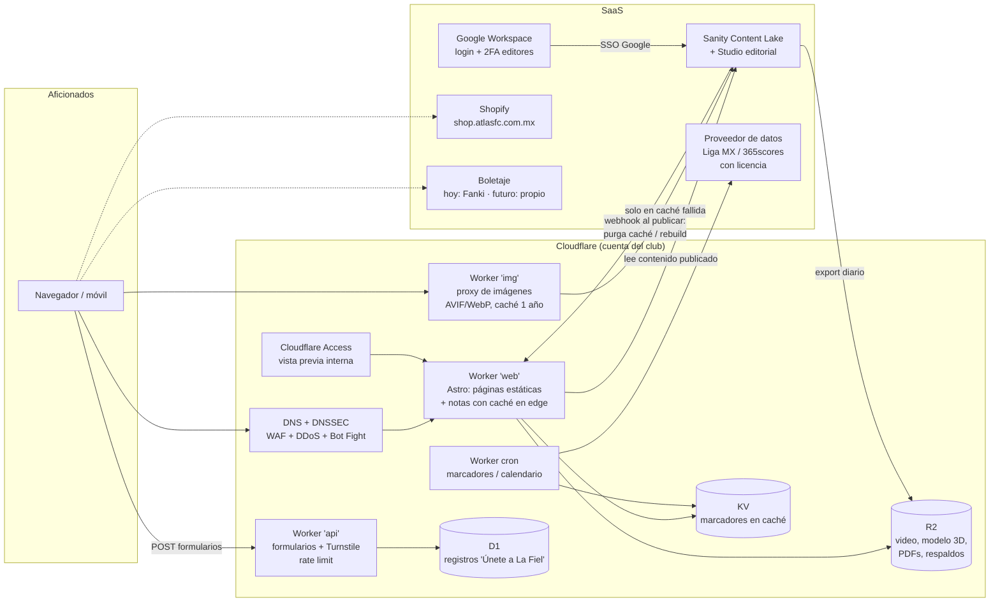

# 03 · Propuesta de arquitectura — atlasfc.com.mx

**Preparado por:** Nuclea Solutions · **Fecha:** 27 de octubre de 2026
**Base:** hallazgos medidos en `02-auditoria-tecnica.md` y datos crudos en `datos/`.

> Convención: **[Medido]** = dato obtenido en esta auditoría. **[Precio público]** = precio de lista consultado el 27/10/2026 en el sitio oficial del proveedor. **[Estimación]** = cálculo propio; el supuesto se indica junto a la cifra.

---

## 1. Punto de partida (resumen de lo medido)

| Tema | Situación actual |
|---|---|
| Plataforma | Webflow (header `x-wf-region: us-east-1`, activos en `cdn.prod.website-files.com`), servido por Cloudflare a través de Webflow. DNS en DNSimple. **[Medido]** |
| Costo | ~$900 USD/mes. Cuadra exacto con **Premium en facturación mensual ($39) + add-on de ancho de banda +1.450 TB ($860) = $899/mes** **[Precio público; plan exacto inferido, confirmarlo con la factura]** |
| CMS | ~2,630 notas (439 páginas × 6 notas) en la colección `/post/` **[Medido]**. El límite de Premium es de 20,000 ítems. |
| Peso | Home: **15.8 MB** por visita en móvil, con 62 imágenes cargadas sin hacer scroll **[Medido]** |
| Rendimiento | Home en móvil: Lighthouse 49, LCP 6.9 s **[Medido]** |
| SEO | Las notas no tienen título propio (`<title>Atlas F.C.</title>`), ni meta descripción, Open Graph, H1, canonical ni sitemap **[Medido]** |
| Seguridad | Sin CSP, X-Frame-Options ni X-Content-Type-Options. El formulario manda datos personales a un Google Apps Script público. No hay DMARC **[Medido]** |

**Conclusión clave:** el costo no viene de Webflow en sí, sino del **ancho de banda que generan las imágenes y el video sin optimizar**. Por eso conviene separar dos decisiones:

1. **Optimizar los medios** baja la factura en semanas, incluso sin migrar (ver §6, Fase 0).
2. **Migrar** se justifica por propiedad, seguridad, SEO y por preparar el terreno para boletaje y el modelo 3D, más que solo por el ahorro de hosting.

---

## 2. Opciones evaluadas

### Opción 0 (referencia): quedarse en Webflow, ya optimizado
Corregir los medios dentro de Webflow y bajar el add-on de ancho de banda.

### Opción A: Astro estático en Cloudflare + Payload CMS autohospedado en VPS + R2
- El front se genera con **Astro** (SSG) y se publica en Cloudflare (Workers Static Assets / Pages).
- **Payload CMS** (Node + PostgreSQL) corre en un VPS propio.
- Imágenes y medios en **Cloudflare R2**, transformados con Cloudflare Images.

### Opción B: Astro en Cloudflare + Sanity (CMS administrado) + R2 ← **recomendada**
- El front se genera con **Astro**: las páginas son estáticas y las notas se renderizan en el edge con caché que se purga al publicar.
- **Sanity** es el CMS SaaS. El panel editorial (Sanity Studio) no se aloja en nuestra infraestructura.
- Las imágenes se sirven desde Sanity a través de un proxy de Cloudflare con caché de un año. **R2** guarda video, el modelo 3D, PDFs, galerías históricas y los **respaldos diarios del contenido**.

### Opción C: Vercel + Sanity (o Contentful)
- El front se hace en **Next.js** sobre Vercel Pro, con Sanity como CMS. La variante con Contentful agrega ~$300/mes por el plan Lite **[Precio público según búsqueda; no se pudo abrir la página oficial (HTTP 429)]**.

---

## 3. Comparativa

### 3.1 Costo mensual estimado (USD)

| Concepto | Opción 0 Webflow optimizado | A · CF + Payload/VPS | **B · CF + Sanity** | C · Vercel + Sanity |
|---|---|---|---|---|
| Hosting del sitio | $39 Premium mensual | $5 Workers Paid | $5 Workers Paid | $40 Vercel Pro (2 asientos × $20) |
| Ancho de banda **con 1.5 TB actuales** | $860 (add-on +1.45 TB) | $0 (estáticos sin costo de salida) | $0 | $75 (0.5 TB × $0.15 sobre 1 TB incluido) |
| Ancho de banda **optimizado (~320 GB)** | $210 (add-on +350 GB, con margen para picos; $150 con +250 GB) | $0 | $0 | $0 (dentro de 1 TB) |
| CMS | incluido | VPS 4 vCPU/8 GB ~$40 + PostgreSQL administrado ~$25 + respaldos ~$8 **[Estimación]** | Sanity Growth 4 asientos × $15 = $60 | Sanity Growth $60 |
| Imágenes / medios | incluido | R2 ~$2 + transformaciones ~$8 | R2 ~$2 + transformaciones ~$8 | Optimización de imágenes Vercel ~$5 |
| Monitoreo / WAF | — | ~$10 | $0 (incluido en el plan gratuito de Cloudflare) | $0 |
| **Infraestructura, escenario 1.5 TB** | **$899** (hoy) | **~$98** | **~$75** | **~$180** |
| **Infraestructura, escenario optimizado** | **~$249** | **~$98** | **~$75** | **~$105** |
| Mantenimiento técnico **[Estimación, $50/h]** | 1 h → $50 | 8 h → $400 (parches de SO, Node, DB, respaldos) | 3 h → $150 | 3 h → $150 |
| **Costo total de operación optimizado** | **~$299** | **~$498** | **~$225** | **~$255** |

Fuentes de precios: Webflow (webflow.com/pricing), Cloudflare Workers/R2/Images/Stream (developers.cloudflare.com), Sanity (sanity.io/pricing) y Vercel (vercel.com/pricing), todas consultadas el 27/10/2026. El detalle línea por línea está en `04-modelo-costos.csv`.

### 3.2 Criterios cualitativos

| Criterio | 0 · Webflow optimizado | A · Payload/VPS | **B · Sanity** | C · Vercel |
|---|---|---|---|---|
| Picos (partido, fichaje, preventa) | Bueno, pero un exceso de ancho de banda dos meses seguidos dispara **upgrade automático** de plan | Front excelente (CDN). Si el CMS se cae, no afecta al público | **Excelente**: CDN global, sin cargo por ancho de banda | Excelente técnicamente, pero **el costo crece con el tráfico** |
| Facilidad editorial | Alta (ya lo conocen) | Media-alta (Payload es amigable; hay que personalizarlo) | **Alta**: Studio a la medida, vista previa, borradores programados, roles | Alta (mismo Sanity) |
| Publicación programada / roles | Hay programación, pero los flujos de aprobación, el log de actividad y la publicación por página solo existen en el plan Team ($2,500/mes) | Sí (hay que desarrollarlo) | **Sí**: borradores programados y 5 roles en Growth | Sí |
| Mantenimiento | Mínimo | **Alto**: servidor, DB, parches, respaldos | Bajo | Bajo |
| **Superficie de ataque** | Media: sin control de headers ni CSP; scripts de terceros sin control | **Alta**: panel de administración, API y base de datos propios en internet | **Baja**: el sitio público es estático, no hay panel ni base de datos en nuestro dominio | Baja-media: funciones serverless y riesgo de factura por bots |
| Propiedad de datos | Baja (lock-in en Webflow; la exportación de CMS es limitada) | **Total** | Alta: dataset exportable + respaldo diario en R2 propio | Alta |
| Base para boletaje y 3D | Pobre | Buena | **Muy buena** (Workers, D1, KV, R2 y Turnstile en la misma plataforma) | Buena |
| Riesgo de proyecto | Nulo | Medio-alto | **Bajo-medio** | Medio |

---

## 4. Recomendación: Opción B, Cloudflare + Astro + Sanity + R2, precedida por una Fase 0 de optimización

**Por qué B:**

1. **Seguridad ante ataques automatizados con IA.** Hoy los bots (muchos asistidos por IA) escanean internet buscando paneles de administración, CMS sin parchar y endpoints abiertos. En B **no existe nada de eso en el dominio del club**:
   - El sitio público son archivos estáticos y un Worker de solo lectura.
   - El panel editorial lo opera Sanity (SaaS) y se entra con las cuentas de Google Workspace del club, que ya usan Gmail (MX `smtp.google.com`), con 2FA obligatorio.
   - Los formularios pasan por un Worker con **Turnstile** y límite de peticiones, y los datos personales nunca quedan expuestos en un endpoint público.

   La opción A, en cambio, obliga a cuidar 24/7 un servidor con panel de administración propio.
2. **Costo predecible.** Cloudflare no cobra salida de datos por estáticos ni por R2. Un pico de 5× en día de fichaje **no cambia la factura**, cosa que sí pasa en Webflow (add-ons y upgrade automático) y en Vercel (cobro por GB).
3. **El equipo editorial gana.** Sanity Studio se configura con su lenguaje: nota, galería, video de YouTube, alineación, ficha de partido, borrador programado y vista previa en el diseño real.
4. **Propiedad del canal.** El contenido se exporta todos los días a un bucket R2 **del club**. Si mañana se cambia de CMS, los datos ya están en casa. Esto sostiene la narrativa de "devolvemos la propiedad de su canal digital".
5. **Misma plataforma para lo que sigue.** Boletaje (Workers + D1 + Turnstile + colas) y el modelo 3D (R2 + caché inmutable) viven en la misma cuenta de Cloudflare, sin sumar proveedores.

**Por qué no A:** es la de mayor propiedad, pero **cuesta más operarla que la B** (~$498 contra ~$225 al mes) y tiene la mayor superficie de ataque. Solo la recomendaríamos si el club exige que el CMS esté en su propia base de datos por motivos legales.

**Por qué no C:** técnicamente es equivalente, pero el ancho de banda se cobra (riesgo en picos y ataques de bots) y sumaría un proveedor más cuando llegue el boletaje.

**Por qué no quedarse en Webflow:** la Opción 0 sí ahorra (ver Fase 0) y **la vamos a ejecutar de todos modos**. Pero en Premium no se pueden poner headers de seguridad, no hay roles ni flujos editoriales (eso requiere el plan Team de $2,500/mes), el SEO de noticias tiene un techo y no sirve como base para boletaje propio.

---

## 5. Arquitectura objetivo (Opción B)

### 5.1 Componentes y decisiones

| Componente | Decisión | Razón |
|---|---|---|
| Framework | **Astro 5**: salida estática y rutas "on-demand" solo para `/noticias/[slug]` | Envía 0 KB de JS por defecto; las "islas" de JS solo se cargan donde hacen falta (carruseles, marcador en vivo) |
| Publicación de notas | Webhook de Sanity → Worker purga la etiqueta de caché de esa nota y del listado | La nota sale **en segundos**, sin reconstruir 2,600 páginas |
| Imágenes | Las sube el editor en Sanity; se sirven por `img.atlasfc.com.mx` (Worker) con `srcset`, AVIF/WebP y ancho máximo de 1600 px | El ancho de banda de Sanity solo se consume en caché fallida; a los aficionados nunca les llega el original de 6,595 px |
| Video | Videos de nota: **YouTube** con fachada ligera (la miniatura carga primero y el reproductor solo al hacer clic). Video del hero: clip de 6–8 s, ≤600 KB, servido desde R2, **solo en escritorio y después del LCP**; en móvil se muestra el póster | Elimina los ~3.9 MB de video que hoy carga la home |
| Fuentes | 2 familias (display + texto), autohospedadas en woff2 con subset latino | Hoy se cargan 6 familias de Google + Typekit (~1 MB y 45 peticiones) |
| Marcadores/calendario | Un Worker cron consulta al proveedor **con licencia** y guarda en KV; el front lee `/api/partidos` de su propio dominio | Hoy el navegador llama directo a `webws.365scores.com` (API no oficial: frágil y sin acuerdo explícito) |
| Formularios | `POST /api/unete` → Worker valida Turnstile y aplica rate limit → D1 (o CRM) | Reemplaza el Apps Script público que hoy recibe nombre, teléfono y correo sin validación |
| Seguridad HTTP | CSP estricta, HSTS con `includeSubDomains; preload`, `X-Content-Type-Options`, `Referrer-Policy`, `Permissions-Policy`, `frame-ancestors 'none'` | Hoy no se envía ninguno de estos headers, salvo HSTS básico |
| Correo | DMARC `p=none` → `quarantine` → `reject` en 6 semanas, con DKIM de Google Workspace | Hoy cualquiera puede mandar correos haciéndose pasar por el club (phishing de boletos) |
| Acceso editorial | Login de Sanity con Google Workspace + 2FA obligatorio; 5 roles (Administrador, Editor en jefe, Redactor, Fotógrafo, Solo lectura) | Mínimo privilegio; las bajas de personal se resuelven desde Google |
| Respaldo | Export diario del dataset de Sanity a R2 con 90 días de retención | Propiedad y recuperación ante errores o borrados |
| Analítica | GA4 (ya existe `G-C69DE74GF3`) cargado con consentimiento + Cloudflare Web Analytics (sin cookies) | Cumple LFPDPPP y da métricas aunque el usuario rechace cookies |

### 5.2 Presupuestos de rendimiento (obligatorios en CI)

| Página | Peso máximo en primera visita (móvil) | LCP p75 | INP p75 | CLS |
|---|---|---|---|---|
| Home | **1.5 MB** (hoy 15.8 MB) | ≤ 2.5 s | ≤ 200 ms | ≤ 0.1 |
| Nota | **900 KB** | ≤ 2.0 s | ≤ 200 ms | ≤ 0.1 |
| Listado de noticias | **1.0 MB** | ≤ 2.5 s | ≤ 200 ms | ≤ 0.1 |
| JS total por página | ≤ 150 KB comprimido | | | |

Lighthouse CI corre en cada *pull request* y bloquea el merge si se rebasa un presupuesto.

### 5.3 Plan de optimización de medios y su efecto en el ancho de banda

Base medida: Webflow sirve 14.1 MB en la home móvil, de los cuales **10.1 MB son JPEG/PNG** (4.7 MB en solo 2 fotos de más de 400 KB) y **3.9 MB son video**. En una nota promedio sirve 1.7 MB, de los cuales 1.3 MB son JPEG.

| Palanca | Qué se hace | Evidencia | Ancho de banda resultante **[Estimación, aplicada en secuencia sobre 1.5 TB]** |
|---|---|---|---|
| Punto de partida | — | — | **1.50 TB** |
| 1. Formato moderno + tamaño responsivo | AVIF (con WebP de respaldo) vía `srcset`/`sizes`, ancho máximo de 1600 px y 600 px para tarjetas | Experimento con 12 imágenes reales: **−96.6 %** (de 6,984 KB a 235 KB). Se asume −90 % para ser conservadores | **~0.50 TB** (−67 %) |
| 2. Video en un servicio o formato dedicado | Hero: póster AVIF en móvil y clip de ≤600 KB en R2 para escritorio, cargado después del LCP. Videos editoriales: YouTube con fachada ligera | El hero hoy son 3.8 MB por visita a la home | **~0.32 TB** (−12 % adicional) |
| 3. Lazy load efectivo | Solo se cargan las imágenes del primer pantallazo; los carruseles cargan bajo demanda | Hoy se descargan 62 de 100 imágenes sin scroll | **~0.28 TB** (−3 % adicional) |
| 4. Higiene editorial | Límite de 1600 px al subir (en Sanity se transforma automáticamente; en Webflow, por regla editorial) | Fotos de 6,595 px subidas hoy | Evita que el consumo vuelva a crecer |
| **Total** | | | **≈ 0.28–0.32 TB/mes (−79 a −81 %)** |

**¿Video en Cloudflare Stream o en R2?** Para el hero, R2 sale más barato: ~140k visitas de escritorio × 600 KB ≈ 84 GB, con **$0 de egreso**. En Stream costaría ~$24/mes ($1 por 1,000 minutos entregados + $5 de almacenamiento). Stream conviene para **contenido propio de video bajo demanda** (resúmenes exclusivos para abonados, por ejemplo) porque entrega bitrate adaptativo y puede restringir acceso. Los videos públicos de notas se quedan en YouTube, donde el club ya publica y donde el costo es cero.

**Efecto en el costo:** en Webflow, pasar de 1.5 TB a ~0.3 TB permite bajar el add-on de $860 a $150–210 al mes. En Cloudflare (opciones A y B), el ancho de banda no se cobra, pero la optimización sigue importando por la **experiencia** (LCP) y por el **consumo de datos de los aficionados**: la home actual se come 16 MB del plan móvil de cada visitante.

---

## 6. Ruta recomendada (resumen; el detalle está en `05-plan-migracion.md`)

| Fase | Duración | Qué se logra | Costo mensual resultante |
|---|---|---|---|
| **0 · Quick wins en Webflow** | 2 semanas | Imágenes, video y fuentes optimizados; sitemap, títulos SEO, DMARC; formulario seguro | De $899 a **~$189–249** (al bajar el add-on de ancho de banda, 3–6 semanas después de optimizar) |
| 1 · Fundaciones | 3 semanas | Cuenta Cloudflare del club, modelo de contenido en Sanity, design system en Astro | Igual |
| 2 · Construcción + migración de contenido | 6 semanas | Sitio completo en staging con las ~2,630 notas | Igual |
| 3 · Cutover sin caída | 1 semana | Cambio de DNS con TTL bajo y rollback listo | **~$75 + mantenimiento** |
| 4 · Estabilización | 2 semanas | Monitoreo, ajustes y baja de Webflow | ~$75 |

---

## 7. Integración futura

### 7.1 Plataforma de boletaje propia
La arquitectura B deja listas las piezas para que el boletaje sea un **producto aislado** que comparta identidad visual y de aficionado, pero no el riesgo:

- **Dominio separado** (`boletos.atlasfc.com.mx`) y despliegue independiente. Una falla o un ataque al boletaje no tumba el sitio de noticias, y al revés tampoco.
- **Identidad del aficionado ("ID Rojinegro")**: un solo inicio de sesión para boletos, tienda y beneficios. Los datos de "Únete a La Fiel" (D1) son la semilla de esa base, que hoy vive en una hoja de Google.
- **Sala de espera virtual** (Cloudflare Waiting Room; requiere plan Business o superior de Cloudflare, a contratar solo cuando arranque el boletaje) para preventas: absorbe picos de 50–100× sin escalar servidores.
- **Anti-bots y anti-reventa**: Turnstile + rate limiting + reglas WAF por zona/partido.
- **Pagos**: se delegan a un procesador certificado PCI DSS (p. ej. Stripe, Conekta, Mercado Pago). **El club no toca datos de tarjeta.**
- **Contenido ↔ boletos**: la ficha del partido en Sanity tiene un campo `ventaBoletos` (estado, URL, fecha de apertura). Hoy apunta a Fanki y mañana a la plataforma propia, sin rediseñar el sitio.

### 7.2 Modelo 3D del nuevo estadio (oscuro, rojo y negro, la cancha como protagonista)

| Aspecto | Especificación |
|---|---|
| Formato | **glTF 2.0 binario (`.glb`)** |
| Geometría | Compresión **Draco** (o Meshopt) sobre la malla; LOD en 3 niveles (tribunas en baja resolución, cancha en alta) |
| Texturas | **KTX2/Basis Universal**, máximo 2048 px para la cancha y 1024 px para tribunas; materiales oscuros con emisivos rojos en lugar de texturas pesadas |
| Presupuesto de peso | **≤ 2.5 MB** para la primera vista (LOD bajo + texturas comprimidas); **≤ 8 MB** en total con el detalle completo, que se carga de forma progresiva |
| Carga | **Nunca en la ruta crítica**: se muestra un póster AVIF (≤ 120 KB) y el visor (three.js o `<model-viewer>`, ~150 KB comprimido) se importa dinámicamente **al hacer clic en "Explorar el estadio"** o cuando la sección entra en pantalla y el navegador está ocioso |
| Dispositivos modestos | Si `navigator.connection.saveData` está activo o el dispositivo tiene ≤ 4 GB de memoria, se ofrece un recorrido en video (YouTube) en lugar del 3D |
| Hosting | R2 con `Cache-Control: public, max-age=31536000, immutable` y nombres con hash |
| Impacto en LCP | **0 ms**: el LCP siempre es el póster o el titular |

---

## 8. Riesgos de la recomendación y cómo se mitigan

| Riesgo | Probabilidad | Mitigación |
|---|---|---|
| Pérdida de tráfico orgánico en el cambio de URLs | Media | Mapa 301 completo (incluidas las URLs `/articles/` heredadas que hoy dan 404), validación con crawler antes del cutover, monitoreo en Search Console por 8 semanas |
| Curva de aprendizaje del equipo editorial | Media | Studio en español y a la medida, 2 sesiones de capacitación, guía visual, 2 semanas de acompañamiento |
| Cambio de precios de Sanity | Baja | El contenido se exporta a diario a R2; el front no depende de nada exclusivo de Sanity |
| Dependencia de Cloudflare | Baja | Astro produce HTML estándar: se puede mover a otro CDN en días |
| Datos de marcadores sin licencia | Media | Formalizar el proveedor (Liga MX / 365scores) antes del cutover |
