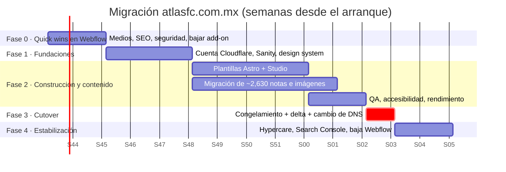

# 05 · Plan de migración — atlasfc.com.mx

**Arquitectura destino:** Opción B, Cloudflare + Astro + Sanity + R2 (ver `03-propuesta-arquitectura.md`).
**Duración total:** 2 semanas de Fase 0 + **12 semanas** de migración, con cutover en una ventana sin partido.
**Esfuerzo estimado:** ~320 h de migración (rango 260–400 h) + ~32 h de Fase 0. **[Estimación]**

---

## Calendario general

> Las fechas son ilustrativas. El cutover debe caer en una semana **sin partido de local, sin cierre de fichajes y sin preventa**. La ventana ideal es la Fecha FIFA o el receso entre torneos.

---

## Fase 0 · Quick wins en Webflow (semanas 1–2, ~32 h)

Reduce la factura y el riesgo **antes** de migrar y sin comprometer nada. Detalle en `02-auditoria-tecnica.md` §9.

| # | Acción | Esfuerzo | Impacto |
|---|---|---|---|
| 1 | Reprocesar las imágenes de CMS de las notas recientes y del plantel: máximo 1600 px de ancho, WebP/AVIF, ≤200 KB. Regla editorial: **no subir originales de cámara** | 8 h | −60 a −80 % de ancho de banda |
| 2 | Hero: quitar el segundo `<video>` duplicado (versión móvil), servir solo el póster en móvil, recomprimir el clip a ≤600 KB y poner WebM antes que MP4 | 3 h | −3.9 MB por visita a la home |
| 3 | Reducir fuentes: 6 familias de Google + Typekit → 2 familias con 3 pesos | 3 h | −0.8 MB y −40 peticiones |
| 4 | Cargar reCAPTCHA solo en `/unete-a-la-fiel` (hoy pesa 349 KB en todas las páginas) | 1 h | −349 KB por página |
| 5 | Activar el sitemap automático de Webflow; `robots.txt` con `Sitemap:`; título y descripción SEO en la plantilla de nota con campos del CMS; H1 en el título de nota; Open Graph con la imagen de la nota | 4 h | Indexación de las ~2,630 notas |
| 6 | Definir el dominio canónico (`www`) y redirigir el apex con 301 | 1 h | Elimina el contenido duplicado |
| 7 | Formulario "Únete a La Fiel": mover el envío a un endpoint con validación (Worker con Turnstile) o, como mínimo, usar el formulario nativo de Webflow con reCAPTCHA verificado | 4 h | Cierra el endpoint público de datos personales |
| 8 | DNS: publicar DMARC `p=none` con reportes, activar DKIM en Google Workspace y agregar CAA | 2 h | Base anti-suplantación de correo |
| 9 | Fijar la versión de Swiper (`swiper@11.x.y`) y agregar `integrity` (SRI) | 1 h | Reduce el riesgo de cadena de suministro |
| 10 | **Bajar el add-on de ancho de banda** tras 2–3 semanas de medir el consumo nuevo, siempre con margen para picos (regla de Webflow: dos meses seguidos por encima del límite = upgrade automático) | 1 h | De $899 a **~$189–249/mes** |
| 11 | Mantener la facturación **mensual** mientras se migra (no comprometer un año con Webflow) | — | Evita pagar meses que no se usarán |

---

## Fase 1 · Fundaciones (semanas 3–5, ~60 h)

| Entregable | Detalle |
|---|---|
| Cuenta Cloudflare **a nombre del club** | Nuclea opera con un usuario delegado y el club conserva la propiedad. Plan Free para empezar (Pro de $25/mes opcional para reglas WAF avanzadas en días de partido) |
| DNS | Migrar la zona de DNSimple a Cloudflare con DNSSEC. Replicar **todos** los registros (MX y SPF de Google, `shop` → Shopify `23.227.38.65`, verificaciones). Durante esta fase `www` sigue apuntando a `cdn.webflow.com` |
| Sanity | Proyecto con datasets `production` y `staging`; login con Google Workspace; 2FA obligatorio en Workspace; 5 roles |
| Modelo de contenido | `nota`, `autor`, `categoria` (Varonil, Femenil, Academia, Club), `galeria`, `video` (YouTube ID), `jugador`, `partido` (con `ventaBoletos`), `patrocinador`, `pagina` |
| Design system | Port de los componentes Webflow (tipografías, colores rojo y negro, tarjetas, carruseles) a componentes Astro + CSS con tokens |
| Repositorio y CI | GitHub del club; Lighthouse CI con presupuestos; previews por rama protegidas con Cloudflare Access |

---

## Fase 2 · Construcción y migración de contenido (semanas 6–11, ~200 h)

### 2.1 Exportación del CMS de Webflow
1. **Fuente principal: API de Webflow** (`GET /v2/collections/{id}/items`, 100 ítems por llamada; ~27 llamadas para ~2,630 notas). Se usa un token de **solo lectura** que se revoca al terminar.
2. **Respaldo:** export CSV de cada colección desde el panel de Webflow, guardado en R2.
3. **Imágenes:** se descargan los originales de `cdn.prod.website-files.com` (unos pocos GB), se suben a Sanity (pipeline de assets) y se conserva una copia en R2.
4. **Rich text → Portable Text:** conversor HTML→Portable Text. Los embeds de YouTube, Instagram y X se mapean a bloques propios.
5. **Normalización de slugs:** se quitan los prefijos `https-www-atlasfc-com-mx-articles-` y los restos de URL-encoding (`c3-a1` → `a`). Se conserva el **ID numérico heredado** (p. ej. `27457`) en el campo `legacyId`.
6. **Validación automática:** conteo de ítems por colección (origen = destino), muestreo visual del 5 % y verificación de que toda imagen referenciada existe.

### 2.2 Mapa de redirecciones 301
El inventario completo de patrones y URLs observadas está en **`datos/inventario-urls-301.csv`** (52 filas). El listado ítem por ítem de las ~2,630 notas se genera automáticamente desde el export del CMS (paso 2.1), sin rastrear el sitio.

| URL actual | URL nueva | Tipo de regla |
|---|---|---|
| `https://atlasfc.com.mx/*` | `https://www.atlasfc.com.mx/*` | 301 de host (hoy ambos responden 200 = contenido duplicado) |
| `http://*` | `https://www.atlasfc.com.mx/*` | 301 en **un solo salto** |
| `/post/{slug}` | `/noticias/{slug-normalizado}` | Tabla generada del export (~2,630 entradas) en Cloudflare Bulk Redirects |
| `/articles/{slug}-{id}` (sitio anterior, **hoy 404**) | `/noticias/{slug}` | Worker: extrae `{id}`, busca por `legacyId` y responde 301. **Recupera tráfico que hoy se pierde** |
| `/noticias?e90dc3fe_page={N}` | `/noticias/pagina/{N}` | Patrón |
| `/home-femenil`, `/home-femenil/` | `/femenil` | 301 |
| `/boletos` (hoy 301 → `/aficion`) | `/boletos` (página nueva) | Se elimina la redirección |
| `/tienda` (hoy 404) | `https://shop.atlasfc.com.mx/` | 301 |
| `/search?query=` | `/buscar?q=` | Patrón |
| Las demás páginas institucionales | Misma ruta | Sin cambio |

**Regla de oro:** ninguna redirección en cadena (máximo un salto), y ninguna URL que hoy responde 200 debe terminar en 404.

### 2.3 Construcción
- Plantillas: home varonil, home femenil, listado de noticias con paginación, nota, galería, plantel, ficha de jugador, calendario/resultados, afición/boletos, patrocinadores, visorías, legales, buscador y 404 útil.
- SEO técnico: `<title>` y descripción por nota, canonical, Open Graph/Twitter, **NewsArticle** en notas, **SportsTeam** en home, **SportsEvent** por partido, **Person** en jugadores, `BreadcrumbList`, sitemap de noticias (Google News, últimas 48 h) + sitemap general, RSS.
- Integraciones: Worker cron de marcadores (proveedor con licencia), formulario con Turnstile → D1, GA4 con consentimiento, enlaces a Shopify y a Fanki.

### 2.4 Pruebas
| Prueba | Criterio de aceptación |
|---|---|
| Redirecciones | Un script recorre el 100 % de la tabla 301 en staging: código 301, destino 200 y un solo salto |
| Paridad de contenido | Los conteos de ítems coinciden; se revisan manualmente 130 notas (5 %) |
| Rendimiento | Lighthouse CI dentro de presupuesto en las 20 plantillas × móvil/escritorio |
| Accesibilidad | axe-core sin errores críticos ni serios; revisión manual con lector de pantalla (VoiceOver/TalkBack) del flujo home → nota → boletos |
| Carga | Prueba de 10× el pico esperado contra staging (las páginas cacheadas deben responder < 100 ms en el edge) |
| Seguridad | securityheaders.com en A; Mozilla Observatory ≥ B+; pruebas del formulario (rate limit, Turnstile, validación) |
| Editorial | Cada rol completa sin ayuda: crear, programar, publicar y despublicar una nota con galería y video |

---

## Fase 3 · Cutover sin caída (semana 12)

| Momento | Acción |
|---|---|
| T−7 días | Bajar el TTL de los registros `www` y apex a 300 s |
| T−3 días | **Congelamiento parcial**: las notas nuevas se publican en Webflow **y** en Sanity (el script delta corre cada hora) |
| T−1 día | Ensayo general: se apunta un host de prueba (`nuevo.atlasfc.com.mx`) a producción y se valida |
| **T0** (martes o miércoles, 10:00, sin partido) | 1) último delta de contenido · 2) se cambian los registros `www` y apex al Worker en Cloudflare · 3) se activan Bulk Redirects · 4) humo: 50 URLs clave + formularios + tabla 301 |
| T0 + 1 h | Se envía el sitemap nuevo en Search Console; se verifica la indexación de 10 notas |
| T0 + 24 h | Revisión de errores 404 (logs del Worker), Core Web Vitals reales (RUM) y tasa de conversión del formulario |

**Por qué no hay caída:** Webflow sigue publicado e intacto durante todo el proceso. El cambio de DNS es gradual (TTL de 300 s) y ambos sitios sirven el mismo contenido durante la propagación.

### Plan de rollback
| Disparador | Acción | Tiempo |
|---|---|---|
| Error crítico: el sitio no carga, faltan secciones o el formulario falla | Devolver `www` a `cdn.webflow.com` y el apex a `198.202.211.1` (valores medidos hoy) | **≤ 5 min** (TTL de 300 s) |
| Caída de tráfico orgánico > 20 % sostenida 7 días | Auditar el mapa 301 y las URLs con 404; el rollback a Webflow sigue disponible | 1 día |
| Webflow | **No se cancela el plan hasta T + 30 días**. Sí se baja el add-on de ancho de banda al mínimo en T + 3 días | — |

---

## Fase 4 · Estabilización (semanas 13–14)
- Hypercare con guardia editorial en los primeros 2 partidos.
- Monitoreo diario en Search Console (cobertura, 404, Core Web Vitals) durante 8 semanas.
- Baja de Webflow en T + 30 días, después de exportar un último respaldo completo.
- Entrega de documentación: runbooks (publicar, revertir, restaurar respaldo, rotar credenciales).

---

## Riesgos

| Riesgo | Prob. | Impacto | Mitigación |
|---|---|---|---|
| Caída de SEO por cambio de URLs | Media | Alto | Mapa 301 completo; hoy las notas tienen señales SEO débiles (título genérico, sin sitemap), así que **es el momento más barato** para reordenar URLs |
| Errores en la conversión del rich text | Media | Medio | Conversor con pruebas y revisión manual del 5 %; las notas fallidas se marcan para corrección |
| Publicación duplicada durante el congelamiento | Alta | Bajo | Script delta cada hora; congelamiento de 72 h máximo |
| Resistencia del equipo editorial | Media | Medio | Studio a la medida, capacitación y acompañamiento; los editores clave participan desde la Fase 1 |
| Datos de marcadores sin licencia | Media | Medio | Formalizar el proveedor antes de T0 |
| Ataque o pico durante el cutover | Baja | Alto | Cutover sin partido; WAF y Bot Fight Mode activos desde el día 1 |
| Dependencia de una sola persona en Nuclea | Media | Medio | Repositorio, cuentas y documentación **a nombre del club**; Nuclea opera con accesos delegados y revocables |

---

## Esfuerzo por bloque (base para el costo único)

| Bloque | Horas [Estimación] |
|---|---|
| Fase 0 · Quick wins | 32 |
| Fundaciones (Cloudflare, Sanity, CI, design system) | 60 |
| Plantillas Astro (14 plantillas) | 80 |
| Studio editorial a la medida (roles, vista previa, programación) | 35 |
| Scripts de migración + validación | 45 |
| Integraciones (marcadores, formularios, analítica) | 25 |
| SEO técnico + mapa 301 | 20 |
| Seguridad (headers, CSP, Access, DMARC) | 12 |
| QA, accesibilidad, rendimiento, carga | 30 |
| Capacitación y documentación | 13 |
| **Total migración (sin Fase 0)** | **320** |

Con una tarifa supuesta de $50 USD/h, la migración cuesta **~$16,000 USD**, en un rango de $13,000 a $20,000 según el alcance final. La tarifa es un supuesto; ajústala en `04-modelo-costos.csv`.
